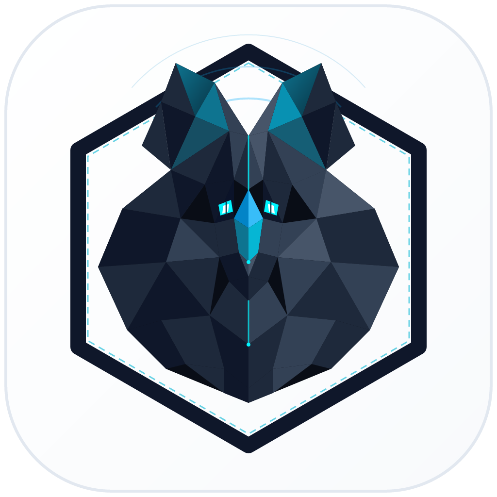
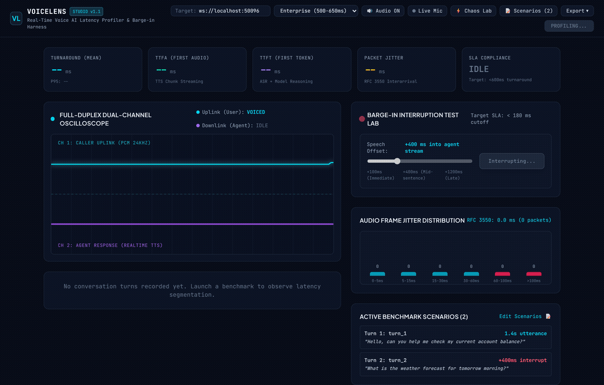
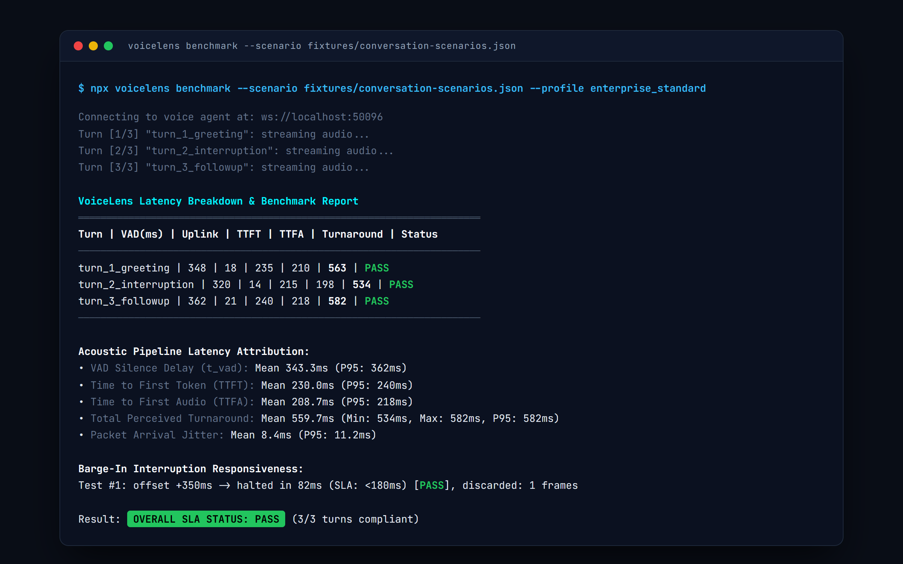
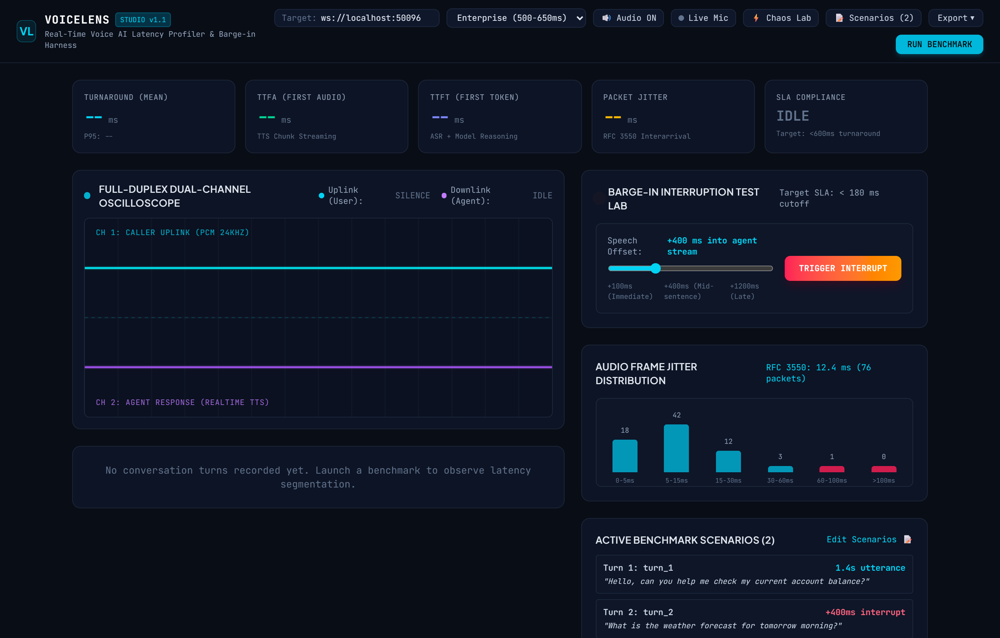
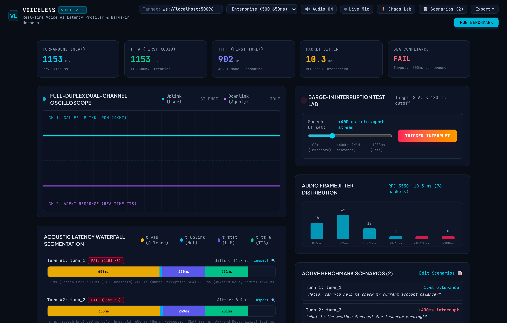
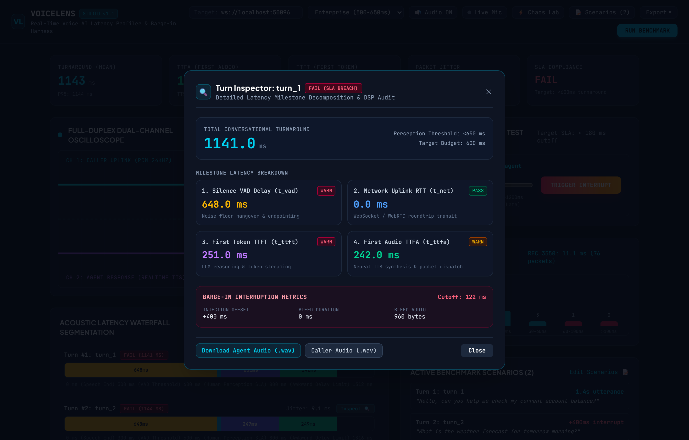
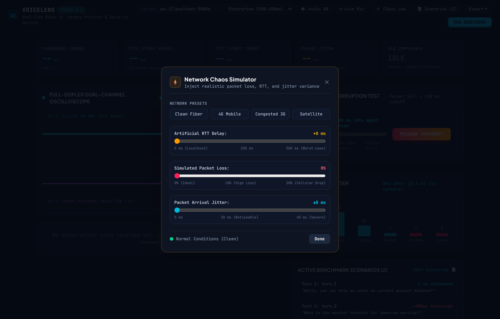
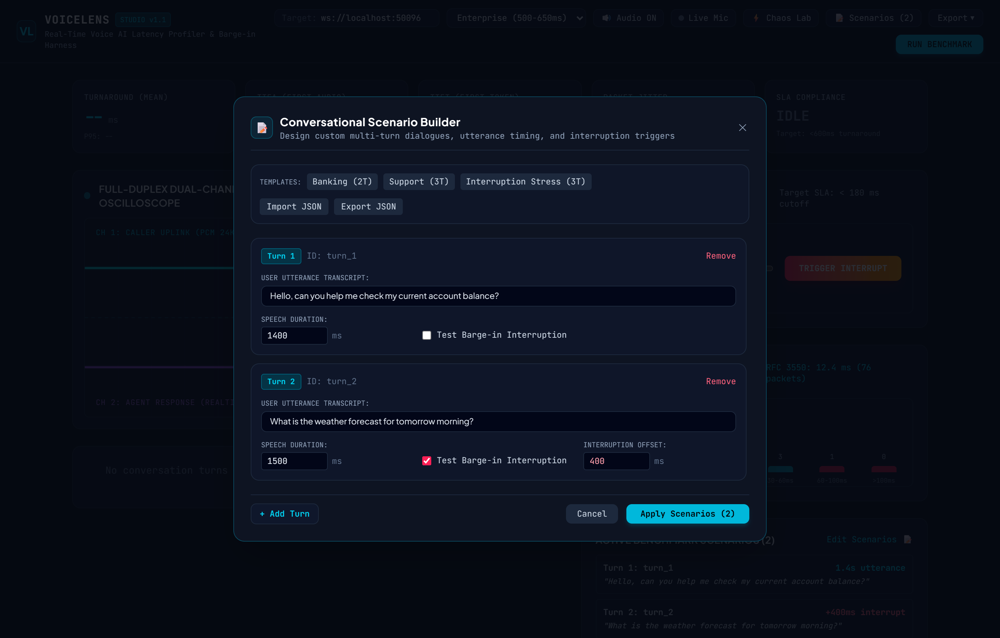
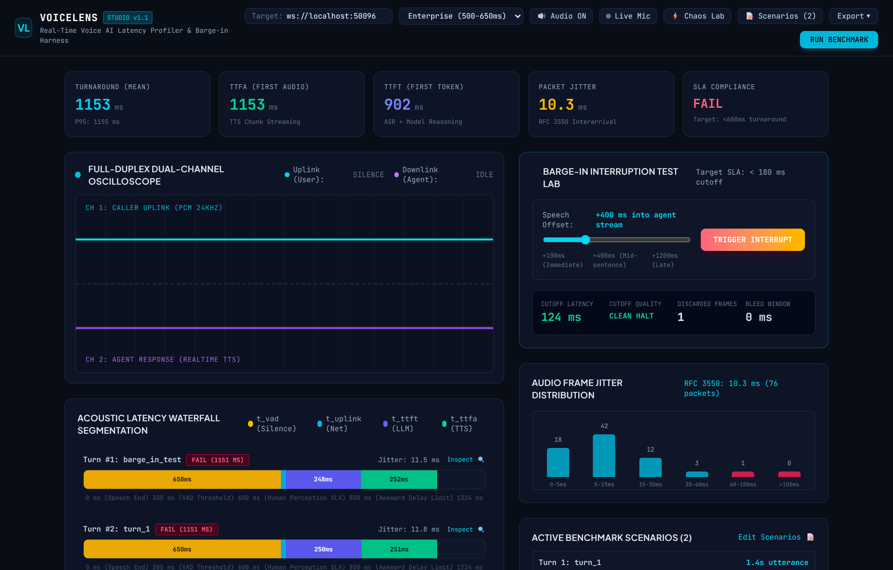

<p align="center">
  
</p>

<h1 align="center">VoiceLens</h1>

<p align="center">
  <strong>Real-time voice AI latency profiler, audio stream benchmarking studio, and barge-in test harness.</strong>
</p>

<p align="center">
  <a href="#why-voicelens">Why VoiceLens</a> &bull;
  <a href="#architecture">Architecture</a> &bull;
  <a href="#quick-start">Quick Start</a> &bull;
  <a href="#cli-commands">CLI Commands</a> &bull;
  <a href="#latency-attribution">Latency Attribution</a> &bull;
  <a href="#web-studio">Web Studio</a> &bull;
  <a href="#ci-cd-integration">CI/CD Integration</a>
</p>

<p align="center">
  
</p>

---

## Why VoiceLens

Voice agents live or die on human conversation thresholds:
* If turnaround latency (time from user silence to the first audible agent byte) exceeds 600 to 800 milliseconds, users perceive an unnatural lag and begin speaking over the agent.
* If interruption response latency (barge-in) exceeds 180 to 200 milliseconds, the agent keeps talking over the user, creating a broken interaction.

Conventional HTTP load testing tools measure request-response HTTP timings, but cannot profile full-duplex audio streams. When a voice agent feels slow, engineering teams struggle to isolate whether the bottleneck sits in client Voice Activity Detection (VAD) silence thresholds, WebSocket or WebRTC transport hops, LLM time-to-first-token (TTFT), or text-to-speech audio frame chunking.

VoiceLens decomposes every hop of the conversational audio loop into nanosecond milestones, automates barge-in cancellation testing, and runs both as a zero-dependency CLI and an embedded visual profiler studio.

---

## Architecture

```
+-------------------------------------------------------------------------+
|                        VoiceLens Core Engine                            |
+-------------------------------------------------------------------------+
                                     |
    +--------------------------------+--------------------------------+
    |                                |                                |
    v                                v                                v
[ Audio DSP Core ]          [ Latency Attribution ]       [ Protocol Adapters ]
  - 16-bit PCM Resampling     - VAD Silence Delay (t_vad)   - OpenAI Realtime WS
  - Energy & ZCR VAD          - Network Uplink (t_net)      - AWS Nova Sonic
  - Formant Synthesizer       - LLM First Token (t_ttft)    - LiveKit / WebRTC
  - Golden Audio Fixtures     - TTS First Audio (t_ttfa)    - Embedded Mock Agent
                              - RFC 3550 Frame Jitter
                              - Barge-In Cutoff & Bleed
                                     |
    +--------------------------------+--------------------------------+
    |                                                                 |
    v                                                                 v
[ Embedded React 19 Studio ]                             [ CLI & CI Harness ]
  - Dual-Channel Audio Canvas Oscilloscope                 - Pass / Warn / Fail SLAs
  - Horizontal Waterfall Timeline Bars                     - Markdown PR Reports
  - Interactive Interruption Simulator                     - JSON Telemetry Export
```

---

## Quick Start

### Installation

Run directly with npx without installing:

```bash
npx voicelens --help
```

Or install globally:

```bash
npm install -g voicelens
```

### 1. Run a Local Latency Benchmark

Benchmark against the built-in acoustic reference agent with an enterprise latency profile:

```bash
npx voicelens benchmark --profile enterprise_standard
```

Output:

<p align="center">
  
</p>

### 2. Test Interruption Responsiveness (Barge-In)

Inject user speech bursts at +200ms, +400ms, and +600ms into the agent audio stream to assert that audio halts in under 180ms:

```bash
npx voicelens barge-in --offsets 200,400,600 --sla 180
```

### 3. Launch the Embedded Web Studio

Open the visual profiler with the live dual-channel oscilloscope and waterfall timeline:

```bash
npx voicelens studio --port 50095
```

---

## Visual Studio

<p align="center">
  
</p>

The embedded Web Studio runs locally on port 50095 (or custom port via `--port`) and provides:

* **Dual-Channel Oscilloscope:** 60fps HTML5 Canvas visualizer rendering caller uplink (cyan) and agent downlink (violet) waveforms, audio RMS energy, and VAD speech activity.
* **Latency Waterfall Breakdown:** Horizontal stacked bars segmenting each turn into VAD silence confirmation, network uplink, LLM thinking, and TTS audio delivery.
* **Interactive Turn Deep-Dive Inspector:** Click any turn to review exact milestone timestamps and download genuine 24kHz linear PCM `.wav` audio files for both caller and agent channels.
* **Barge-In Interruption Lab:** Interactive slider to set speech offset, trigger mid-utterance interruptions, and inspect cutoff latency and rogue frame bleed in real time.
* **Network Degradation & Chaos Simulator:** Inject artificial round-trip delay (RTT), simulated packet loss, and jitter variance on the fly with presets for 4G mobile, congested cellular, and satellite uplinks.
* **Conversational Scenario Builder:** Author multi-turn dialogue trees, customize utterance timings, configure barge-in offsets per turn, and import/export scenario definitions as JSON.
* **Audible Speaker & Live Microphone Engine:** Stream 24kHz audio directly through browser speakers with instant hardware cutoff on barge-in, or speak into your microphone to profile your own voice in real time.
* **One-Click Audit Report Export:** Export structured Markdown compliance reports or raw JSON telemetry ready for engineering review and SLA audits.

<p align="center">
  
</p>

<p align="center">
  
</p>

<p align="center">
  
</p>

<p align="center">
  
</p>

<p align="center">
  
</p>

---

## Latency Attribution Breakdown

VoiceLens calculates total turnaround latency using five distinct acoustic milestones:

$$\text{Turnaround} = t_{\text{vad}} + t_{\text{net}} + t_{\text{ttft}} + t_{\text{ttfa}}$$

| Metric | Symbol | Description | SLA Target |
|:---|:---:|:---|:---:|
| **VAD Silence Confirmation** | `t_vad` | Time from caller stopped speaking to VAD threshold trigger | < 350 ms |
| **Network Uplink** | `t_net` | Transit time for audio frames to reach server | < 40 ms |
| **Time to First Token** | `t_ttft` | Server ASR and LLM model reasoning to first text token | < 250 ms |
| **Time to First Audio** | `t_ttfa` | TTS model synthesis start to first playable audio byte | < 200 ms |
| **Total Turnaround** | `t_total` | End of caller speech to start of agent audio playback | **< 600 ms** |
| **Barge-In Cutoff** | `t_barge` | Time from user interruption to agent stream halt | **< 180 ms** |
| **Packet Jitter** | `J` | RFC 3550 packet arrival interval variance | < 15 ms |

### RFC 3550 Jitter Formula

For consecutive packet arrivals $i$ and $j$, with departure times $S$ and arrival times $R$:

$$D(i, j) = (R_j - R_i) - (S_j - S_i)$$

$$J_i = J_{i-1} + \frac{|D(i, j)| - J_{i-1}}{16}$$

---

## CLI Commands

### `voicelens benchmark`

Profiles multi-turn conversations against a voice endpoint.

```bash
Options:
  -t, --target <url>        Target WebSocket endpoint or "mock" (default: "mock")
  -k, --api-key <key>       API key for authenticated endpoints (e.g. OpenAI)
  -p, --profile <name>      Mock profile (ultra_fast, enterprise_standard, congested_telephony)
  -s, --scenario <file>     Path to JSON conversation scenarios file
  --max-ttfa <ms>           SLA threshold for TTFA in milliseconds (default: 600)
  --max-turnaround <ms>     SLA threshold for total turnaround (default: 800)
  --format <format>         Output format: console, markdown, json (default: "console")
  -o, --output <file>       Save report to file
  --fail-on-budget          Exit with code 1 if SLA latency budget is violated
```

Example against a live OpenAI Realtime endpoint:

```bash
npx voicelens benchmark \
  --target wss://api.openai.com/v1/realtime?model=gpt-4o-realtime-preview \
  --api-key $OPENAI_API_KEY \
  --scenario fixtures/conversation-scenarios.json \
  --fail-on-budget
```

### `voicelens barge-in`

Executes interruption stress sweeps across user speech offsets.

```bash
npx voicelens barge-in \
  --target ws://localhost:50096 \
  --offsets 150,300,600,900 \
  --sla 180 \
  --fail-on-budget
```

### `voicelens mock-server`

Runs the standalone local OpenAI Realtime reference server for local testing:

```bash
npx voicelens mock-server --port 50096 --profile enterprise_standard
```

---

## CI/CD Integration

Export GitHub PR comments directly inside GitHub Actions:

```yaml
name: Voice AI Latency SLA Check

on: [pull_request]

jobs:
  benchmark:
    runs-on: ubuntu-latest
    steps:
      - uses: actions/checkout@v4
      - uses: actions/setup-node@v4
        with:
          node-version: 22

      - run: npm ci && npm run build
      - name: Run Latency Benchmark
        run: |
          node bin/voicelens.js benchmark \
            --scenario fixtures/conversation-scenarios.json \
            --format markdown \
            --output benchmark-report.md \
            --fail-on-budget
```

---

## Programmatic TypeScript API

VoiceLens exports its core DSP, timing trackers, and protocol adapters for direct programmatic use:

```typescript
import {
  TurnTracker,
  JitterCalculator,
  BargeInTracker,
  VadDetector,
  OpenAiRealtimeProtocol,
  BenchmarkSuite,
} from 'voicelens';

const protocol = new OpenAiRealtimeProtocol({
  endpointUrl: 'ws://localhost:50096',
});

const suite = new BenchmarkSuite({
  protocol,
  bargeInToleranceMs: 180,
});

const { summary, turns, bargeIns } = await suite.run();
console.log(`Mean Turnaround: ${summary.turnaroundStats.mean} ms`);
```

---

## License

MIT &bull; Created by [Alexandr Motologa](https://github.com/alexandrmotologa)
